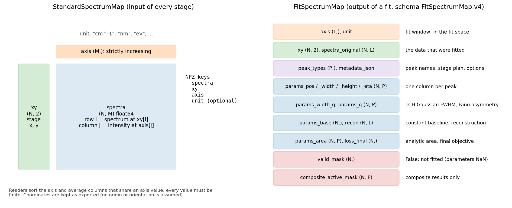

# Data format

Two containers carry data between the stages: `StandardSpectrumMap` (a
map of spectra, the input and output of every preprocessing stage) and
`FitSpectrumMap` (the result of a fit). Both are frozen dataclasses with an
NPZ file format that loads with `numpy.load(..., allow_pickle=False)`.



## StandardSpectrumMap

```python
from hyper_spectral_process import StandardSpectrumMap

ssm = StandardSpectrumMap(spectra, xy, axis, unit="cm^-1")   # validates on construction
ssm = StandardSpectrumMap.from_unsorted(spectra, xy, axis, unit)  # any axis order
ssm.save("map.npz")
ssm = StandardSpectrumMap.load("map.npz")
sub = ssm.select(mask_or_indices)          # subset of spectra
new = ssm.replace(spectra=processed)       # copy with a field replaced
```

| field | shape, type | meaning |
|---|---|---|
| `spectra` | `(N, M)` float64 | intensity of spectrum `i` at `axis[j]`; finite |
| `xy` | `(N, 2)` float64 | stage coordinates of every spectrum (instrument units, often um), kept as exported |
| `axis` | `(M,)` float64 | spectral axis, strictly increasing, `M >= 2` |
| `unit` | str | axis unit, e.g. `"cm^-1"`, `"nm"`, `"eV"` (the energy conversions require `"nm"`) |

`from_unsorted` sorts the axis and averages columns that share an axis
value, as the original specification prescribes; the readers use it. Rows
are independent: their order does not matter, the coordinates place them.

NPZ keys: `spectra`, `xy`, `axis` (required) and `unit` (optional scalar
string). Files written by other tools with only the three required keys load
too.

**Raster helpers.** `raster_indices(xy)` finds the unique x and y values
(rounded to 6 decimals) and the column/row of every spectrum;
`to_image(values, xy)` puts one value per spectrum on that raster
(`image[iy, ix]`, NaN where a node has no spectrum; two spectra on one node
raise). All map plots use them.

## FitSpectrumMap

The result of `fit_map` (and of `composite_fit`); schema `FitSpectrumMap.v4`.
`L` is the number of samples in the fit window, `P` the number of peaks.

| NPZ key | attribute | shape | meaning |
|---|---|---|---|
| `__schema__` | | | `"FitSpectrumMap.v4"` |
| `axis`, `unit` | `axis`, `unit` | `(L,)` | the fit window, in the fit space (energy after a wavelength-to-energy fit) |
| `xy` | `xy` | `(N, 2)` | coordinates of all input spectra |
| `spectra_original` | `spectra_original` | `(N, L)` | the data that were fitted (normalised unless un-normalised) |
| `peak_types` | `peak_types` | `(P,)` | canonical type of every peak |
| `params_pos`, `params_width`, `params_height` | `pos`, `width`, `height` | `(N, P)` | position, width (meaning per type, see [peak fitting](peak_fitting.md#lineshapes)), height |
| `params_eta` | `eta` | `(N, P)` | 0 Gaussian, 1 Lorentzian, the fixed eta (height fraction), the TCH eta (area fraction), 0 for Fano |
| `params_width_g`, `params_q` | `width_g`, `q` | `(N, P)` or empty | TCH Gaussian FWHM, Fano asymmetry (0 for other types) |
| `params_base` | `base` | `(N,)` | constant baseline |
| `recon` | `recon` | `(N, L)` | reconstruction on the window |
| `params_area` | `area` | `(N, P)` | analytic peak area (NaN for Fano) |
| `loss_final` | `loss_final` | `(N,)` | objective at the end of the fit |
| `valid_mask` | `valid_mask` | `(N,)` | False for rows not fitted (their parameters are NaN) |
| `composite_active_mask` | `active_mask` | `(N, P)` | composite results only: slot used by the pixel's winning variant |
| `metadata_json` | `metadata` | | JSON: peak names and specifications, stage plan, options, axis conversion, run time |

Strings are stored as unicode arrays. Files of the original code store them
as object arrays; load those with `FitSpectrumMap.load(path, allow_pickle=True)`
only if they come from a trusted source.

Useful methods: `peak_names`, `peak_index(name)`, `reconstruct(rows, axis)`,
`components(rows, axis)` (the individual peak curves), `peak_areas()`,
`peak_fwhms()`. `VariantSelection.save(path, xy)` writes the per-pixel
variant choice (`variant_id_map.npz`: `variant_id`, `variant_names`,
`k_active`, `bic_per_variant`, `bic_raw_per_variant`, `wrmse_per_variant`,
`drift_pen_per_variant`, `drift_max_per_variant`, `valid_mask`, `xy`).
