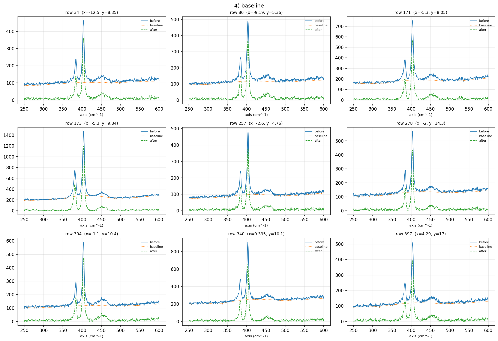
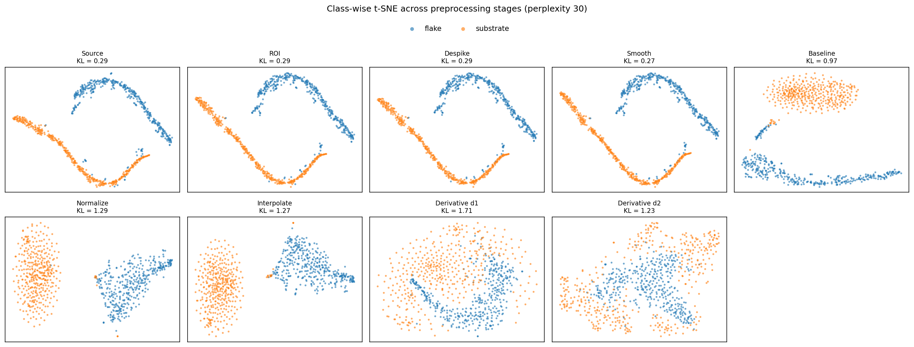
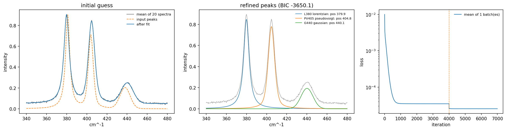
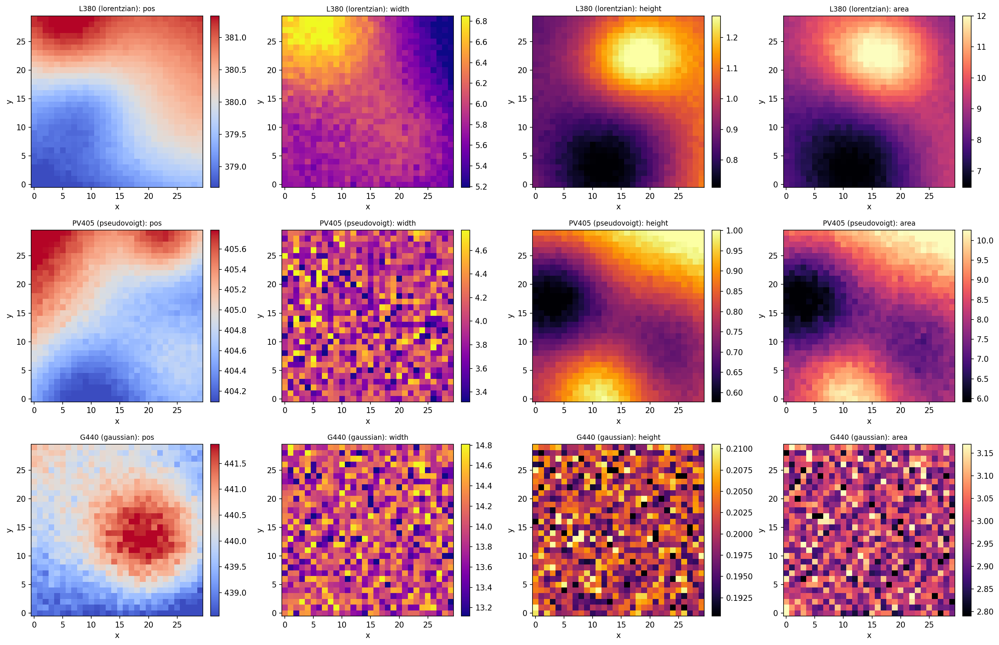
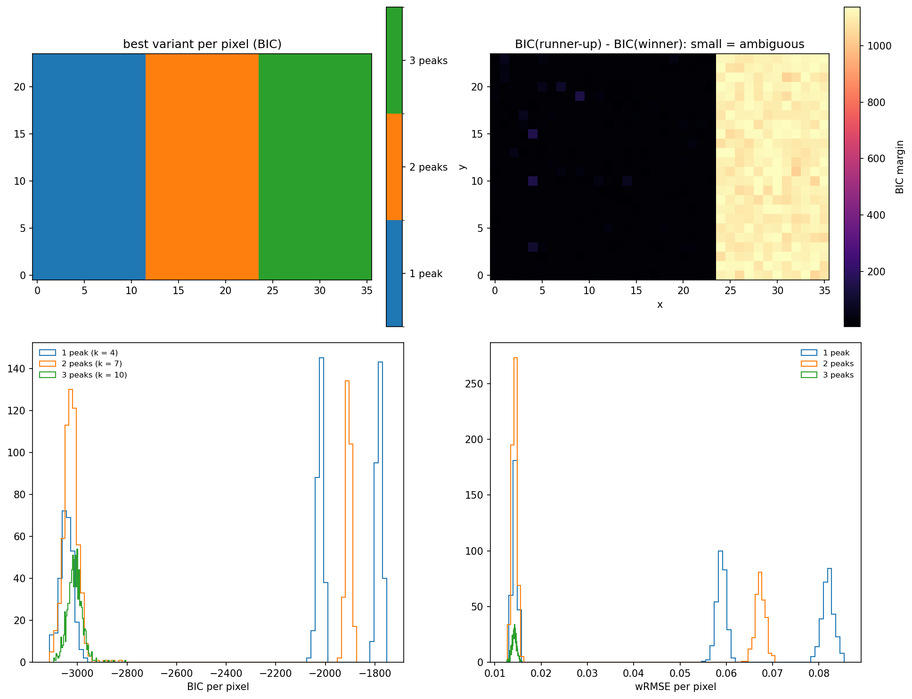
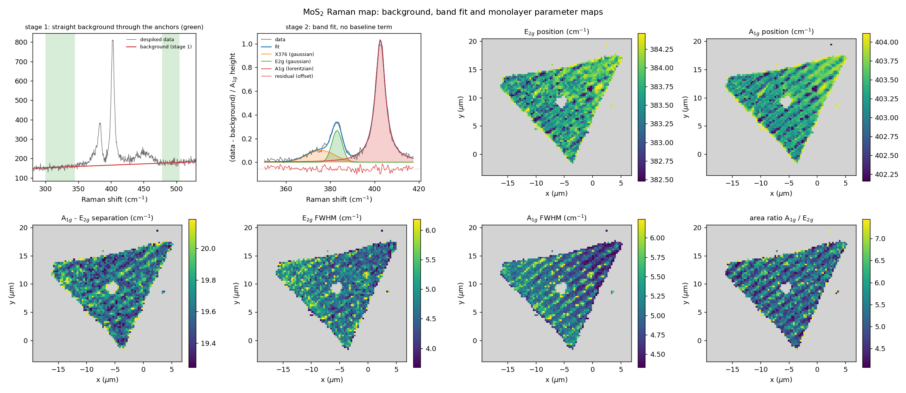
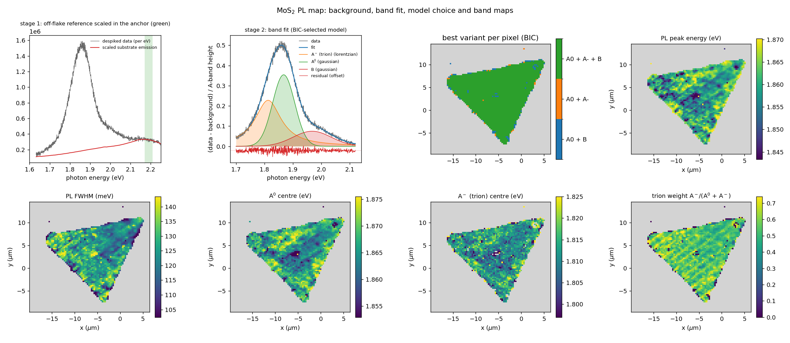

# Examples

The scripts in `examples/` show what the functions do on synthetic and
measured data and how analyses are put together from them. Each script is
configured by the `AppConfig` dataclass at its top (and module-level peak or
pipeline definitions); run it from any directory, outputs go to
`example_output/` there. Set `device="cuda:0"` in the fitting examples to
use a GPU. The numbers below are from CPU runs; GPU runs agree to the
float32 tolerance.

| script | shows | data |
|---|---|---|
| `01_convert_instrument_files.py` | readers and the NPZ format | a LabSpec-format export written from the bundled map |
| `02_preprocess_map.py` | a full preprocessing run with QA images and t-SNE | bundled Raman map, on-flake and off-flake spectra as two classes |
| `03_fit_map.py` | fitting every pixel; outputs and summary figures | synthetic map with known truth |
| `04_variant_selection.py` | per-pixel model choice by BIC and the composite result | synthetic map with three regions |
| `05_mos2_raman_pl_analysis.py` | a worked analysis: measured Raman and PL maps -> position, width and separation maps | bundled MoS2 maps |

## 01: converting instrument files

Each entry of `AppConfig.inputs` is `(path, reader, unit)`; the script reads
the file and writes `<name>.npz`. To be self-contained it first writes a
10 x 8 corner of the bundled Raman map in the LabSpec layout
(`write_horiba_txt`) and converts it back (80 spectra x 1024 points).

## 02: preprocessing with QA

The bundled Raman map is split into on-flake spectra (MoS2 A1g band clearly
above a straight background) and substrate spectra, 400 of each, saved as
two inputs with the class names `flake` and `substrate`, and run through

    roi (250-600 cm^-1) -> despike (wh, threshold 7, m 3) -> smooth (5, 3) -> baseline (peakstrip 11-201)
    -> normalize (instance) -> interp (0.5 cm^-1) -> deriv (orders 1, 2)

The run directory holds `npz_proc_d0/1/2`, the metadata table and the QA
images. Baseline QA of nine random flake spectra (before, baseline, after):

Class-wise t-SNE of every stage (perplexity 30): the two classes stay
separated up to the interpolation; the derivative panels mix them, since the
normalised substrate spectra are mostly noise and noise dominates their
derivatives.

## 03: fitting a map

A 30 x 30 synthetic map with a Lorentzian (380 cm^-1), a TCH pseudo-Voigt
(405 cm^-1) and a weak broad Gaussian (440 cm^-1) whose positions, widths
and heights vary smoothly, plus a constant background and noise (standard
deviation 2 % of the main band), is fitted with the defaults of the original
template: per-pixel 0-1 normalisation, a fitted constant baseline, an initial
guess on the average of 20 random pixels, `coarse` (4000 iterations,
lr 5e-3) and `fine` (3000, lr 1e-3) stages, weak springs (`*_limit_reg`
1e-5 on the main peaks, 1e-4 on the weak band). The initial-guess figure
(averaged spectrum, refined peaks, loss):

Parameter maps written by `save_fit_outputs` (summary/parameter_maps.png):

The script prints the errors against the truth: median absolute position
errors 0.018, 0.022 and 0.118 cm^-1 and median height errors 0.6 %, 0.7 % and
1.7 % for the three bands (900 spectra in 169 s on 4 CPU threads). The
weak, broad band is the least constrained, as expected at its signal level.

## 04: choosing between peak models per pixel

A 24 x 36 synthetic map has one band on the left third, a shoulder band
added in the middle third and a third band added on the right. Three
variants (1, 2 and 3 peaks) are fitted to every pixel and
`select_variants` picks the lowest BIC (with the drift penalty, alpha = 100).
The winner map, the BIC margin between the best two variants, and the BIC and
wRMSE histograms of every variant (`save_variant_plots`):

Each variant wins exactly its own region (288 of 864 pixels each). The
margin is small (about `3 ln L`, the price of three extra parameters) where
the extra peak is absent and large where it is present. The composite result
(`composite__FitSpectrumMap_v4.npz`) holds three peak slots with NaN where a
pixel's winner has no such peak.

## 05: Raman and PL maps of monolayer MoS2

Data: the bundled maps of monolayer MoS2 on a wrinkled substrate (88 x 81
points, 0.3 um step, 532 nm excitation; see
`examples/data/mos2_wrinkled/README.md`). The goal is a set of parameter
maps; the analysis is built from the library functions in two stages so that
no baseline term competes with the bands during the band fit.

**Stage 1, background extraction** (`subtract_baseline(mode="anchors")`):

- Raman: the off-flake spectra are a straight line between 300 and
  505 cm^-1, so the background of every spectrum is a straight line fitted to
  the anchor ranges 300-345 and 478-505 cm^-1 (outside the fitted bands and
  the 2LA(M) band near 450 cm^-1).
- PL: the substrate emits a broad band that no low-order polynomial
  describes, so the background is a measured spectrum: the mean of the
  off-flake pixels (more than 4 pixels from any on-flake pixel, 3966 spectra),
  smoothed (Savitzky-Golay 31, 3), scaled to every spectrum by least squares
  in the anchor 2.17-2.21 eV (above the B exciton, below the Raman lines).

**Axis and Jacobian** (PL): the map is stored on a Raman-shift axis; it is
converted to wavelength by relabelling only (`raman_shift_to_wavelength(...,
jacobian=False)`), because the detector pixels have a constant width in
wavelength (0.214 nm, uniform within 1 %, checked by the script), so the
counts per pixel are a density per unit wavelength; then to photon energy
with the lambda^2 Jacobian (`wavelength_to_energy(..., jacobian=True)`), which
makes them a density per unit energy, the quantity the band shapes describe.

**Stage 2, band fit** (`fit_map` / `fit_variants`, `fit_baseline=False`,
spectra divided by the height of their main band, no minimum shift):

- Raman, window 350-418 cm^-1: a weak broad Gaussian near 376 cm^-1
  (unassigned; it carries intensity between the bands), Gaussian E2g,
  Lorentzian A1g. Pixels whose A1g height exceeds the map median by 5 robust
  standard deviations are fitted (2,261); pixels whose A1g-E2g separation is
  more than 4 robust standard deviations above the median are left out of
  the maps (a small few-layer island near the centre), leaving 2,201
  monolayer pixels.
- PL, window 1.70-2.12 eV, zero weight on the one detector column the export
  interpolated: three variants, A0 + B, A0 + A- and A0 + A- + B (Gaussian
  A0, Lorentzian A-, Gaussian B), compared pixel by pixel with the BIC
  (2,297 pixels fitted).

Raman results (medians over the monolayer pixels): E2g at 383.69 cm^-1,
A1g at 403.33 cm^-1, separation 19.62 cm^-1, FWHM 4.72 (E2g) and 5.02
(A1g) cm^-1, area ratio A1g/E2g 5.2. The position and width maps follow the
wrinkle stripes.

PL results: the BIC chooses all three bands in 95.6 % of the fitted pixels
(A0 + B 3.4 %, A0 + A- 1.0 %). The peak energy and FWHM of the total fitted
band, which do not depend on how the band is decomposed (found on a 0.2 meV
grid), have medians of 1.860 eV and 124 meV. Following common practice for
room-temperature monolayer MoS2, the low-energy component is assigned to the
negative trion A- (K. F. Mak et al., Nat. Mater. 12, 207 (2013); S. Mouri,
Y. Miyauchi and K. Matsuda, Nano Lett. 13, 5944 (2013)); the median fitted
centres are 1.866 eV (A0) and 1.811 eV (A-), and the median trion weight
A-/(A0 + A-) where A- is selected is 0.54.

The two maps are shown in their own stage coordinates: the PL export's
coordinates are offset from the Raman export's by about (-0.4, -5.9) um,
so register the images (for example by cross-correlating intensity maps)
before combining Raman and PL values pixel by pixel. Run time on 12 CPU
threads: about 5 minutes for the Raman map and 14 minutes for the three PL
variants; a GPU shortens both.
