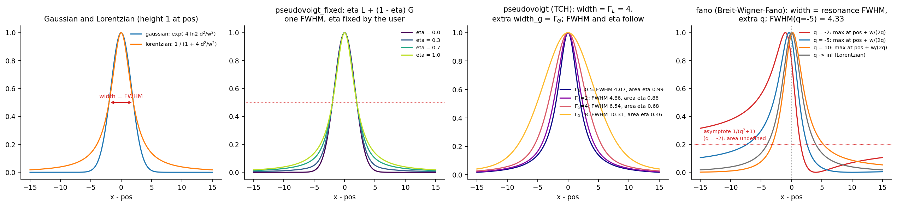
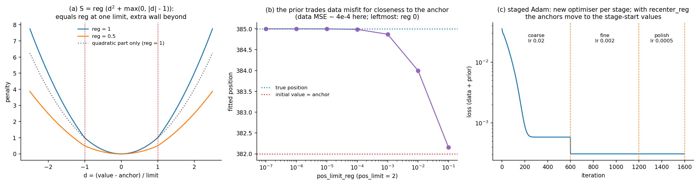
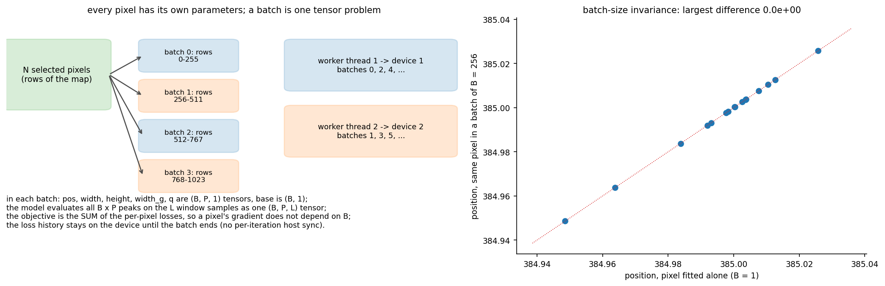
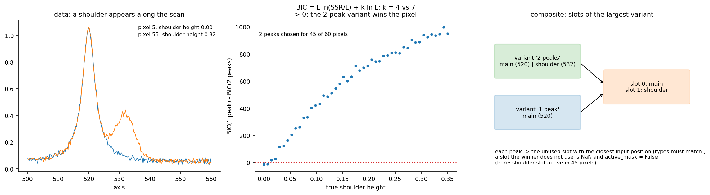

# Peak fitting

Module: `hyper_spectral_process.fit`. Every pixel of a map gets its own
multi-peak model

    recon(x) = base + sum_j height_j * profile_j(x; pos_j, width_j, ...)

fitted by a staged Adam optimisation of the mean squared residual plus a soft
spring prior that keeps every parameter near its anchor value. Pixels are
fitted in batches, each batch one tensor problem on a CPU or GPU.

- [Lineshapes](#lineshapes) (`lineshapes.py`)
- [Peak specification](#peak-specification) (`specs.py`)
- [Objective and spring prior](#objective-and-spring-prior) (`objective.py`)
- [Staged optimisation](#staged-optimisation) (`engine.py`)
- [Batching and devices](#batching-and-devices) (`engine.py`)
- [Fitting a map](#fitting-a-map) (`prepare.py`, `initial_guess.py`, `fit_map.py`)
- [Model variants and per-pixel BIC selection](#model-variants-and-per-pixel-bic-selection) (`variants.py`)
- [Outputs](#outputs) (`result.py`, `outputs.py`)

## Lineshapes

Every profile has height 1 at its maximum, so `height` is the peak height in
data units.



| `type` | profile (`d = x - pos`) | `width` | extra parameters | fitted parameters |
|---|---|---|---|---|
| `gaussian` | `exp(-4 ln2 d^2 / w^2)` | FWHM | | pos, width, height |
| `lorentzian` | `1 / (1 + 4 d^2 / w^2)` | FWHM | | pos, width, height |
| `pseudovoigt_fixed` | `eta L(d; w) + (1 - eta) G(d; w)` | FWHM (shared) | `eta` (fixed, required) | pos, width, height |
| `pseudovoigt` | Thompson-Cox-Hastings: `eta_h L(d; F) + (1 - eta_h) G(d; F)` (see below) | Lorentzian FWHM `Gamma_L` | `width_g` = Gaussian FWHM `Gamma_G` | pos, width, width_g, height |
| `fano` | `(q gamma + d)^2 / ((q^2 + 1)(gamma^2 + d^2))`, `gamma = w/2` | resonance FWHM | `q` (asymmetry), hard range `q_range` | pos, width, q, height |

For the TCH pseudo-Voigt (P. Thompson, D. E. Cox and J. B. Hastings,
J. Appl. Cryst. 20, 79 (1987)) the profile FWHM `F` and the mixing follow
from the two widths (`tch_fwhm_eta`):

    F^5 = G^5 + 2.69269 G^4 L + 2.42843 G^3 L^2 + 4.47163 G^2 L^3 + 0.07842 G L^4 + L^5
    eta = 1.36603 r - 0.47719 r^2 + 0.11116 r^3,   r = L / F,

Here `eta` is the Lorentzian fraction of the **area**: the Voigt profile is
approximated by `eta L_a + (1 - eta) G_a` with unit-area components of FWHM
`F`. Scaled to unit height the profile is `eta_h L + (1 - eta_h) G` with the
height fraction `eta_h = (eta / C_L) / (eta / C_L + (1 - eta) / C_G)`
(`C_G = 1.0645`, `C_L = pi/2`, the areas per unit FWHM of unit-height
components). It agrees with the Voigt profile within about 1 % of the peak
height, and fitting it to a Voigt profile returns `Gamma_L` and `Gamma_G`
within 1 % when `Gamma_G / Gamma_L` is above about 0.3 (both checked against
`scipy.special.voigt_profile` in the tests); a small Gaussian width under a
dominant Lorentzian is poorly determined (at `Gamma_G / Gamma_L = 1/30` the
fitted `Gamma_G` is 14 % low), a limit of the approximation itself.
`Gamma_G -> 0` gives a Lorentzian, `Gamma_L -> 0` a Gaussian. The stored
`eta` of a TCH peak is the area fraction `eta`.

The Breit-Wigner-Fano profile has its maximum (value 1) at `pos + w / (2q)`,
not at `pos`, and a zero at `pos - q w / 2`; far from the resonance it tends
to `1 / (q^2 + 1)`, so its integral diverges. `|q| -> infinity` is the
Lorentzian; the sign of `q` sets the side of the long tail. Keep `q_range`
on one sign to stop the fit from flipping the asymmetry.

Derived quantities (`peak_area`, `peak_fwhm`; `FitSpectrumMap.peak_areas()`,
`.peak_fwhms()`): the area is the analytic integral, `height * FWHM *
((1 - eta) * 1.0645 + eta * 1.5708)` for Gaussian, Lorentzian and fixed-eta
peaks, `height * F / (eta / C_L + (1 - eta) / C_G)` for `pseudovoigt`, NaN
for `fano`; the profile FWHM is `width`, the TCH `F`, or for Fano
`w (1 + p^2) / |1 - p^2|` with `p = 1/q` (infinite for `|q| <= 1`).

## Peak specification

```python
from hyper_spectral_process.fit import PeakSpec, StageSpec, FitConfig

A1G = PeakSpec("lorentzian", pos=403.5, width=5.0, height=1.0,
               pos_limit=3.0, pos_limit_reg=1e-4,        # spring on the position
               width_limit=3.0, width_limit_reg=1e-4,
               height_limit=0.5, height_limit_reg=0.0,   # free height
               name="A1g")
PV = PeakSpec("pseudovoigt", 405.0, 4.0, 0.8, 3.0, 0.0, 3.0, 0.0, 0.5, 0.0,
              extra={"width_g": 5.0, "width_g_limit": 3.0, "width_g_limit_reg": 0.0})
FANO = PeakSpec("fano", 1580.0, 30.0, 0.8, 10.0, 0.0, 10.0, 0.0, 0.2, 0.0,
                extra={"q": -5.0, "q_range": (-50.0, -0.5), "q_limit": 5.0, "q_limit_reg": 0.0})
cfg = FitConfig(peaks=(A1G, PV), stages=(StageSpec("coarse", 15000, 5e-3), StageSpec("fine", 8000, 2e-3)),
                fit_baseline=True, x_fit_range=(350.0, 420.0))
```

`pos`, `width`, `height` (and `width_g`, `q`) are the initial values; each has
a `*_limit` (the natural scale of a deviation, axis or data units) and a
`*_limit_reg` (the spring strength, 0 = free); see the next section. Types
accept aliases (`"pv"`, `"pvf"`, `"bwf"`, ...) and are stored canonical;
`extra` keys that do not belong to the type, a fixed `eta` outside [0, 1], an
initial `q` outside `q_range` and non-positive limits raise.

`FitConfig`:

| field | meaning | default |
|---|---|---|
| `peaks`, `stages` | peak specifications, stage plan | required |
| `sort_peaks_by_pos` | order peaks by initial position (stage `active` indices and result columns use this order) | True |
| `base_init`, `fit_baseline` | constant baseline start value; fit it or keep it fixed | 0.0, False |
| `x_fit_range` | fit window `(xmin, xmax)`, clipped to the data; no overlap raises | full axis |
| `downweight_x_ranges`, `downweight_factor` | residuals inside these ranges are multiplied by the factor (0 ignores them) | none, 0.2 |
| `height_sign_reg` | weight of the penalty on negative heights | 5.0 |

## Objective and spring prior

For one spectrum with residual `r = recon - y` and per-sample weights `w`
(1, or `downweight_factor` inside the down-weighted ranges):

    loss = sum_l w_l r_l^2 / sum_l w_l
         + mean_j S(pos_j) + mean_j S(width_j) + mean_j S(height_j) + mean_j S(width_g_j) + mean_j S(q_j)
         + height_sign_reg * mean_j max(0, -height_j)

with the spring prior

    S(theta) = reg * (d^2 + max(0, |d| - 1)),   d = (theta - theta_anchor) / limit.



The quadratic term always acts; the linear term adds a wall beyond one
`limit`; at `|d| = 1` the penalty equals `reg` (panel a). `reg` is therefore
in the units of the data term: compare it with the mean squared residual at
convergence (for 0-1 normalised spectra typically 1e-5 to 1e-3). Panel b
shows the trade-off for a noisy Lorentzian at 385 fitted from an anchor at
382 (1.5 limits away): up to `reg ~ 1e-4` the data win, at `reg ~ 1e-2` the
spring holds the peak near its anchor. As a rule of thumb (from the original
template):

| `*_limit_reg` | effect (0-1 normalised data) |
|---|---|
| 0 | free |
| 1e-5 | almost free |
| 1e-4 | comparable to the data at convergence: a gentle bias |
| 1e-3 | data and prior balance near the limit |
| 1e-2 | the parameter rarely reaches the limit |
| >= 0.1 | the parameter stays near its anchor |

With raw intensities the data term scales with the square of the intensity
and the regs must scale with it. A diagnostic: if after the fit the prior is
much larger than the data term, the springs dominate. Pitfall: a spring pulls
every pixel towards the same anchor and therefore shrinks pixel-to-pixel
variation; use `reg = 0` for parameters whose spatial variation is the result.

## Staged optimisation

`StageSpec(name, iters, lr, active="all", recenter_reg=True)`. Stages run in
order; every stage creates a new Adam optimiser with its learning rate
(panel c above). `active` (peak indices in fitting order) restricts the model
to some peaks in that stage, e.g. main peaks first and shoulders later;
inactive peaks contribute nothing to the model and are not moved by the data
(the spring prior and the negative-height penalty still act on them, which
moves them only if they are away from their anchors or negative). With
`recenter_reg` the spring anchors are set to the current values when the
stage starts, so the prior pulls towards the previous stage's result instead
of the initial guess (the loss drops at the stage boundary in panel c for this
reason).

After every step the widths are clamped to at least `1e-4`, heights to at
least `-1e3` and `q` to `q_range`. Adam's step is about `lr` in the units of
each parameter, so `lr` sets how far parameters can move per iteration:
choose it for the axis units (cm^-1 positions need larger steps than eV
positions) and make the coarse stage long enough for the largest expected
shift. The defaults of the original template are `15000` iterations at
`5e-3` then `8000` at `2e-3`.

## Batching and devices



`BatchFitter(x, y, weights, table, cfg, device)` holds `B` spectra: every
parameter is a `(B, P, 1)` tensor (`base` is `(B, 1)`), the model evaluates
all peaks on all window samples as one `(B, P, L)` tensor, and the objective
is the **sum** of the per-pixel losses, so each pixel's gradient, and with it
its result, does not depend on the batch size (right panel: the same pixels
fitted alone and in a batch of 256 agree exactly). `fit_batches(...,
devices=("cuda:0", "cuda:1"), batch_size=256)` cuts the selected pixels into
batches and gives batch `b` to `devices[b % n]`, one worker thread per device;
the loss history stays on the device until a batch ends, so devices run
concurrently. Requested CUDA devices that do not exist raise. Memory scales
with `B * P * L`; raise `batch_size` until the GPU is full.

## Fitting a map

```python
from hyper_spectral_process.fit import MapFitOptions, InitialGuessOptions, fit_map
fit = fit_map(ssm, cfg, MapFitOptions(devices=("cuda:0",), batch_size=512),
              initial_guess=InitialGuessOptions(select_mode="random", k_random=20))
fit.result            # FitSpectrumMap
fit.loss_history      # (n_batches, n_iter)
fit.initial_guess     # InitialGuess: refined peaks, averaged spectrum, BIC
```

Preparation (`prepare_map`), in order:

1. **Selection** (`select_mode`): `"all"`, `"indices"` (`indices`) or `"random"`
   (`k_random` rows, `seed`).
2. **Low-signal skip** (`skip_low_signal`, default on): rows whose maximum is
   below `skip_low_signal_factor` (0.1) times the mean row maximum are not
   fitted (`valid_mask = False`).
3. **Axis space** (`fit_axis_space`): for a map in nm, `"eV"` or `"cm^-1"`
   converts the map to energy with the intensity Jacobian
   `(lambda / lambda_ref)^2` (`lambda_ref` = centre of the wavelength fit
   window, so intensities keep their scale) and converts the peaks given in
   nm (positions exactly, widths and limits by `|dE/d lambda|` at the peak,
   heights by the Jacobian, the Fano asymmetry mirrored, `q -> -q`, because
   the axis direction reverses), the fit window and the down-weighted ranges.
   The fitting order stays the order by wavelength, so stage `active`
   indices and result columns mean the same peaks as in nm. The result is
   stored on the energy axis. Lineshapes such as a Lorentzian
   exciton band are defined per unit energy, which is why the Jacobian
   matters for broad photoluminescence bands.
4. **Normalisation** (`normalize_01`, default on): each row is mapped to
   [0, 1] by its own minimum and range over the full axis;
   `unnormalize_results` maps heights, baselines, areas, data and
   reconstruction back to the input scale. The minimum shift adds an offset,
   so use `fit_baseline=True` with it.
5. **Fit window and weights** from `x_fit_range` and `downweight_x_ranges`.

**Initial guess** (`fit_initial_guess`, optional): the prepared spectra of
the chosen rows (`InitialGuessOptions.select_mode`: `"all"` valid rows,
`"indices"`, `"random"` `k_random`) are averaged and fitted with the full
stage plan; the fitted values replace the initial values of the peaks
(limits and regs are kept) and every pixel starts from them.
`format_peaks_block(guess.peaks, conversion=...)` prints them as `PeakSpec`
source code (converted back to nm after an energy-space fit) to paste into a
script.

## Model variants and per-pixel BIC selection

When different regions of a map need different peak sets (a band present in
one place and absent in another), fit several **variants** and choose one per
pixel:

```python
from hyper_spectral_process.fit import fit_variants, select_variants, composite_fit, input_peaks_of
variants = (("1 peak", (MAIN,)), ("2 peaks", (MAIN, SHOULDER)))
fits = fit_variants(ssm, variants, cfg, opts)                 # one MapFit per variant, shared initial-guess average
results = {name: f.result for name, f in fits.items()}
sel = select_variants(results, input_peaks=input_peaks_of(fits), drift_penalty_alpha=0.0)
comp = composite_fit(results, sel, input_peaks_of(fits))
```



For every pixel and variant

    BIC = L ln(SSR / L) + k ln(L),

with `SSR` the sum of squared residuals over the `L` window samples (stored
data minus stored reconstruction) and `k` the number of fitted parameters (3
per Gaussian, Lorentzian or fixed-eta pseudo-Voigt peak, 4 per TCH
pseudo-Voigt or Fano peak, plus 1 with `fit_baseline`). The lowest value
wins; pixels not valid in every variant get `variant_id = -1`.
`sel.delta_bic()` (runner-up minus winner) shows where the choice is
ambiguous (differences below about 2 are weak, above 10 very strong).
Warnings are logged when a variant's median wRMSE is more than 5 times the
best (degenerate variant) or more than 5 % of the pixels have a margin below 1.

**Drift penalty** (`drift_penalty_alpha > 0`): a variant without the right
peak can sometimes reach a low SSR by moving its peaks far from where they
belong. The penalty

    alpha * sum_j max(0, |pos_j - pos_j,input| / pos_limit_j - 1)^2

is added to its BIC (0 while every peak stays within one `pos_limit` of its
input position); values of 100-1000 are a reasonable start against BIC
values of thousands. `sel.drift_max` holds the largest normalised drift.

**Composite** (`composite_fit`): one `FitSpectrumMap` whose peak slots are
those of the largest variant; every peak of every variant is assigned, in
fitting order, to the unused slot with the closest input position (the peak
types must match). Each pixel holds its winner's parameters and
reconstruction; slots the winner does not use are NaN and
`active_mask[pixel, slot]` is False. Pitfall: the BIC chooses the variant
that describes a spectrum best for its number of parameters; it does not
prove a physical component is present (an imperfect lineshape can be
compensated by an extra peak).

## Outputs

`FitSpectrumMap` (see [data format](data_format.md)) holds per pixel and
peak `pos`, `width`, `height`, `eta` (fixed, or the TCH value), `width_g`,
`q`, the analytic `area`, `base`, `recon`, `loss_final` and `valid_mask`, plus
`metadata` (peak names and specifications, stages, options, axis
conversion, timing). Methods: `reconstruct(rows, axis)`,
`components(rows, axis)`, `peak_areas()`, `peak_fwhms()`, `peak_index(name)`,
`save(path)`, `load(path)`. `fit_metrics(fsm)` gives per pixel wRMSE,
wNRMSE (wRMSE over the data range), wR2 (clipped at 0) and the mean
residual.

`save_fit_outputs(fit, out_dir, stem)` writes the NPZ, `params_<stem>.csv`
(type, position, width, height, eta, area per peak), `metrics_<stem>.csv`, the
batch-mean loss curve, the initial-guess figure with the refined peaks as
Python source, and the summary figures of [plotting](plotting.md).
