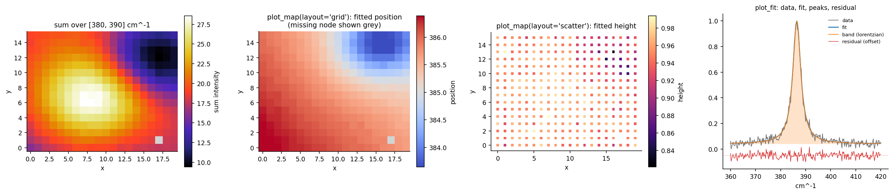

# Plotting

Module: `hyper_spectral_process.plot`. Functions draw into a given axes or
return a figure; nothing is shown or saved implicitly (except the `save_*`
helpers).



## Maps

| function | what it draws |
|---|---|
| `plot_map(ax, xy, values, cmap, vmin, vmax, percentiles, label, layout)` | one value per spectrum on the stage raster (`layout="grid"`: cells of the raster spanned by the coordinates, missing nodes and NaN in grey; `"scatter"`: square markers at the coordinates, for scans that are not rectangular). `percentiles=(2, 98)` clips the colour range to robust limits |
| `band_intensity(ssm, xmin, xmax, aggregate)` | `sum`, `mean` or `max` of every spectrum over an axis range (`(N,)` array) |
| `plot_band_intensity(ssm, xmin, xmax, aggregate, cmap="CMRmap", ax=None)` | the integrated-intensity map of a range (the original heatmap tool) |
| `plot_variant_map(ax, selection, xy)` | discrete map of the variant chosen per pixel |

Any per-pixel array can be mapped, for example a ratio of fitted areas:

```python
from hyper_spectral_process.plot import plot_map
area = fit.result.peak_areas()
plot_map(ax, fit.result.xy, area[:, 1] / area[:, 0], cmap="RdBu_r", percentiles=(2, 98), label="area ratio")
```

## Spectra

| function | what it draws |
|---|---|
| `plot_fit(ax, fsm, idx, residual=True, names=None)` | data, fit and every peak (filled above the baseline) of one row; residual offset below; inactive composite slots are left out |
| `plot_initial_guess(guess)` | the averaged spectrum with the model before and after the initial-guess fit, the refined peaks and the loss history |
| `plot_loss_history(ax, histories, stage_ends)` | mean loss per iteration over batches with a +/- 1 SD band and the stage boundaries |

## Summary figures of a fit

`save_summary_plots(fsm, out_dir)` writes:

| file | content |
|---|---|
| `parameter_maps.png` | per peak: position, width, height and area maps |
| `quality_maps.png` | NRMSE, R^2 and baseline maps |
| `parameter_histograms.png` | per peak: histograms with the median |
| `average_fit.png` | mean data and mean fit over the fitted pixels with the mean residual |
| `sample_fits.png`, `worst_fits.png` | 16 random fits; the 12 fits with the largest NRMSE |
| `ratio_maps.png` | area ratios of peak pairs |
| `position_height_scatter.png` | height against position, coloured by width |

`save_variant_plots(selection, fits, xy, out_dir)` writes the winner map with
the BIC-margin map and the BIC and wRMSE histograms, the mean spectrum and
fit over the pixels each variant wins, and (with a drift penalty) the
drift maps. Examples of both are in [examples](examples.md).
