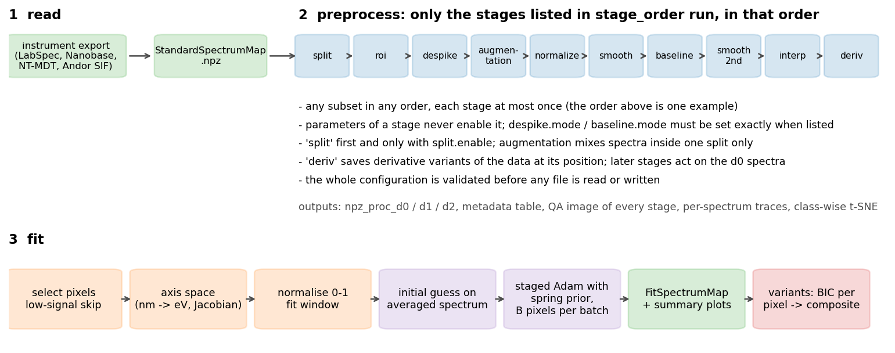
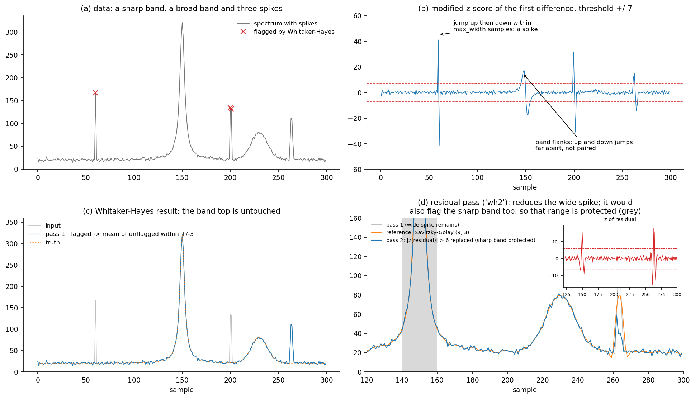
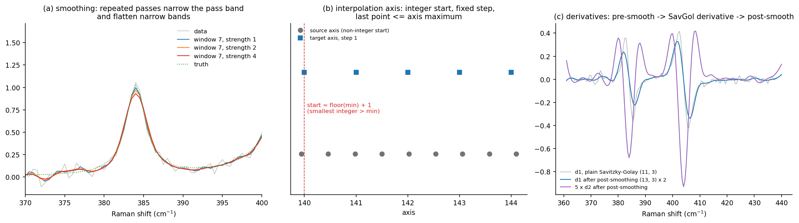
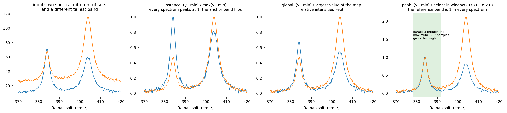
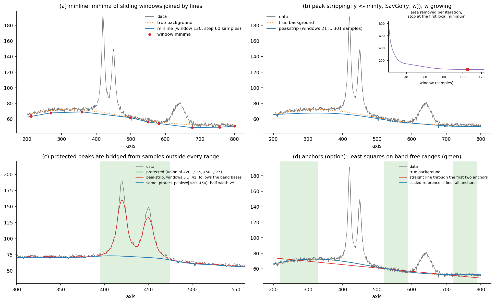
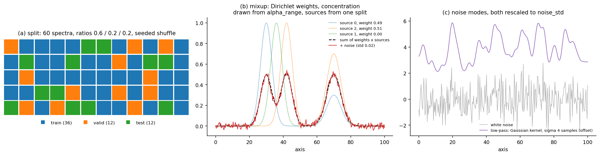
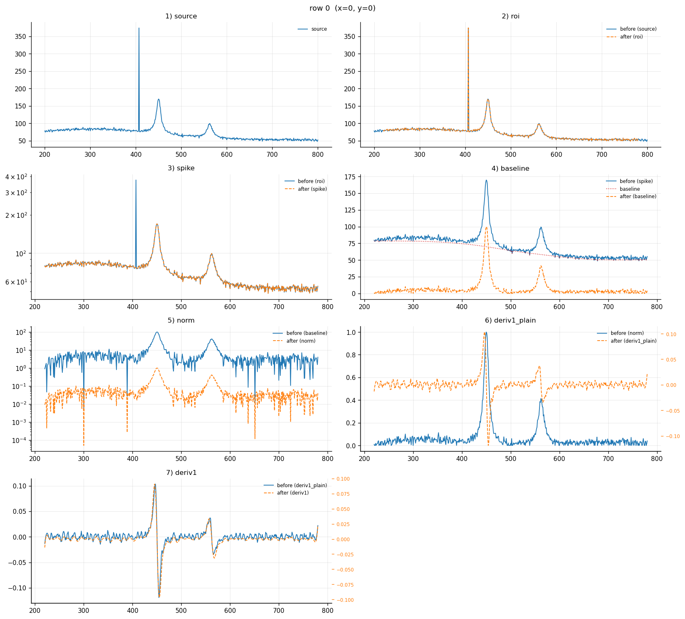
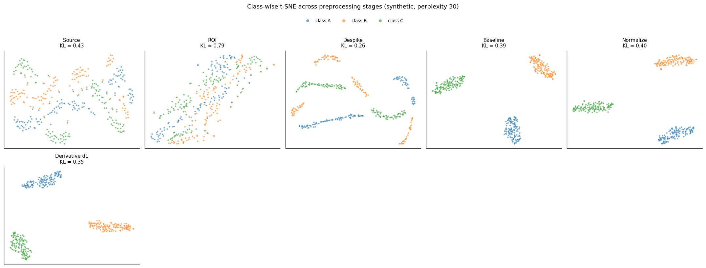

# Preprocessing

Module: `hyper_spectral_process.preprocess`. Every stage is a function of a
`StandardSpectrumMap` that returns a new map; it lives in its own module
(`roi.py`, `despike.py`, `smooth.py`, `normalize.py`, `baseline.py`,
`interpolate.py`, `derivative.py`, `augmentation.py`). The pipeline
(`config.py`, `pipeline.py`) runs any subset of them in a configured order,
and the runner (`runner.py`) processes whole sets of files with metadata and
QA images (`qa.py`).

All window lengths are in **samples**, all ranges in **axis units**.
Parameters that do not fit the data (a window longer than the spectrum, a
range outside the axis, an even Savitzky-Golay window, ...) raise
`ValueError`; nothing is adjusted silently.



- [The pipeline and its validation](#the-pipeline-and-its-validation)
- [roi](#roi), [despike](#despike), [smooth / smooth2nd](#smooth--smooth2nd),
  [normalize](#normalize), [baseline](#baseline), [interp](#interp),
  [deriv](#deriv), [split and augmentation](#split-and-augmentation)
- [QA images](#qa-images)
- [Batch runs: `run_preprocess`](#batch-runs-run_preprocess)

## The pipeline and its validation

```python
from hyper_spectral_process.preprocess import (PreprocessConfig, RoiParams, DespikeParams, BaselineParams,
                                               NormalizeParams, DerivativeParams, run_pipeline)

cfg = PreprocessConfig(
    stage_order=("roi", "despike", "smooth", "baseline", "normalize"),
    roi=RoiParams(xmin=250, xmax=600),
    despike=DespikeParams(mode="wh", wh_threshold=7.0, wh_m=3),
    baseline=BaselineParams(mode="peakstrip", ps_window_min=11, ps_window_max=201),
    normalize=NormalizeParams(mode="instance"),
    derivative=DerivativeParams(orders=()),       # no 'deriv' stage
)
res = run_pipeline(ssm, cfg)
res.final                    # the processed map
res.stages["baseline"]       # snapshot after every stage (keys below)
res.baseline_curve           # (N, M) baseline that was subtracted
```

Rules (checked by `validate_config` before anything is processed):

| rule | why |
|---|---|
| only the stages in `stage_order` run, in that order, each at most once | the order is part of the method (e.g. normalise before or after the baseline) |
| a parameter block never enables its stage | a leftover setting cannot silently change a run |
| `despike.mode` must be `simple`/`wh`/`wh2` when `despike` is listed; `baseline.mode` must be set exactly when `baseline` is listed | an active-looking but unused mode is ambiguous |
| `split` must be first, and present exactly when `split.enable` | splits are assigned on the raw rows |
| `derivative.orders` must be empty unless `deriv` is listed (and non-empty when it is) | as above |
| split ratios non-negative and summing to 1; known augmentation splits and noise modes | |
| at least one NPZ family is saved; the no-augmentation reference needs `augmentation`; the source variant needs the reference | output options |

Snapshot keys of `PipelineResult.stages`: `source`, `roi`, `spike` (or
`spike1`, `spike2` for `wh2`), `augment`, `norm`, `smooth`, `smooth2nd`,
`baseline`, `interp`, and for every derivative order `k`: `deriv{k}_pre`
(when pre-smoothed), `deriv{k}_plain`, `deriv{k}`. `trace_order` lists them
in processing order. The defaults of the parameter blocks are those of the
original run configuration (for example `wh_threshold=3.5`, `wh_m=8`,
`smooth.window=7`, `smooth.strength=2`); set them explicitly for your data.

## roi

`crop_roi(ssm, xmin, xmax, round_decimals=None)` keeps `xmin <= axis <= xmax`
without resampling. `None` means the end of the axis; a range beyond the data
is clipped to it; `xmin > xmax` or fewer than two remaining samples raise.
`round_decimals` optionally rounds the intensities.

Pipeline: `RoiParams(xmin=250.0, xmax=3200.0, round_decimals=None)`.

## despike

Cosmic rays add one to a few very high samples. Three methods
(`DespikeParams.mode`):



**`"wh"`: Whitaker-Hayes** (`despike_whitaker_hayes(ssm, threshold, m, max_width=2, protect=())`;
D. A. Whitaker and K. Hayes, Chemometr. Intell. Lab. Syst. 179, 82 (2018)).

1. First differences `d_k = y[k+1] - y[k]` of every spectrum are scored with
   the modified z-score `z = 0.6745 (d - median(d)) / MAD(d)` (panel b).
2. A spike is a jump `|z_i| > threshold` followed within `max_width` samples
   by a jump of the opposite sign `|z_j| > threshold`, with ordinary
   differences (`|z| <= threshold`) just outside the pair. The samples between
   the two jumps are flagged (panel a). Both upward and downward spikes are
   detected.
3. Every flagged sample is replaced by the mean of the unflagged samples
   within `+/- m` samples (panel c).

The pair condition keeps band flanks from being flagged (a flank is a run of
same-sign jumps); the isolation condition keeps the top of a sharp, strong
band from being flagged (its flanks are themselves large jumps).

| parameter | meaning | pipeline default |
|---|---|---|
| `wh_threshold` | z-score above which a jump counts | 3.5 (function default 7.0) |
| `wh_m` | half-width of the replacement neighbourhood | 8 (function default 3) |
| `wh_max_width` | widest spike detected, samples | 2 |
| `protect` | axis ranges never modified | `()` |

Pitfalls: a spike wider than `max_width`, a spike on the steep flank of a
sharp band and a spike on the first or last sample are not detected; a low
threshold (3.5) flags noise in spectra with heavy-tailed noise; integer data
with many zero differences have `MAD = 0`, which raises (smooth or bin first).

**`"wh2"`: two passes** (`despike_two_pass`). Pass 1 is Whitaker-Hayes
(`wh1_threshold`, `wh1_m`); pass 2 (`despike_residual`) smooths every
spectrum with a Savitzky-Golay filter (`resid_ref_window`,
`resid_ref_polyorder`), scores the residual `y - reference` with the modified
z-score and replaces samples with `|z| > resid_threshold` by the reference
(`resid_replace="ref"`) or by the mean of the unflagged samples within
`+/- resid_m` (`"mean"`, falling back to the reference when a sample has no
unflagged neighbour). Panel d: it reduces a 4-sample spike that pass 1 left.
Pitfalls: the reference is computed from the spectrum *with* the spike, so
the replacement is pulled towards it; the tops of bands narrower than about
`resid_ref_window` samples are flagged too, so protect such bands.

**`"simple"`** (`despike_simple(ssm, threshold)`): every run of differences
with `|d| > sf_threshold` (data units) is replaced by the straight line between
the samples on either side of the run. Simple and fast, but the threshold is
absolute (it depends on the intensity scale) and steep band flanks exceed it.

## smooth / smooth2nd

`smooth_savgol(ssm, window, polyorder=3, mode="interp", strength=1)`:
Savitzky-Golay smoothing applied `strength` times. The window is an odd
number of samples larger than `polyorder` and not longer than the spectrum.
`smooth2nd` is a second, independently configured pass at another position
of the stage order (`PreprocessConfig.smooth2nd`).



Pitfall: the filter works on sample indices, so its width in axis units
scales with the sampling step; a window wider than a band's FWHM (in
samples) lowers and broadens that band, and every extra pass does more of
the same (panel a).

## normalize

`normalize(ssm, mode, round_decimals=None, peak_window=None, peak_refine=2)`
first shifts each spectrum so its minimum is 0, then divides by

| mode | scale | use |
|---|---|---|
| `instance` | the spectrum's own maximum | shapes only; every spectrum peaks at 1 |
| `global` | the largest value of the whole map | keeps intensity differences between spectra |
| `peak` | the height of the tallest peak inside `peak_window` (`peak_height`) | a fixed reference band is 1 in every spectrum, so ratios to it are kept |



`peak_height(axis, y, window, refine)`: with `refine = k > 0` a parabola is
fitted through the window maximum and its `k` neighbours on each side and the
vertex height is used, which keeps single-sample noise out of the scale; if
the maximum is closer than `k` samples to the spectrum edge, or the parabola
is not concave, the sample maximum is used.

Pitfalls: `instance` switches the anchor band from spectrum to spectrum when
two bands have similar heights (panel b); the minimum shift adds an offset
equal to the most negative noise excursion, so a later fit should include a
constant baseline; a non-positive scale (flat spectrum, no band in the
window) raises. Pipeline default: `instance`, `round_decimals=3`.

## baseline

`subtract_baseline(ssm, mode, ...)` returns `(corrected map, baseline (N, M))`;
`clip_negative=True` sets negative corrected values to 0.



**`minline`** (`minline_baseline(x, y, window, step)`, panel a): the minimum of
every window `[s, s + window)` for `s = 0, step, 2 step, ...` (windows at the
end are shortened) becomes a node; the nodes are joined by straight lines and
extrapolated linearly. It follows the lower envelope of the noise. A window
longer than the spectrum, or fewer than two distinct nodes, raises. Defaults
`window=500`, `step=150` samples, which is too long for short spectra.

**`peakstrip`** (`peakstrip_baseline(y, window_min, window_max, polyorder, protect)`, panel b):
the spectrum is padded on both sides with `ceil(M/2)` copies of its end
values; then for the windows `w = window_min, window_min + 2, ..., window_max`
(made odd, `strip_windows`) it is replaced by `min(s, SavGol(s, w, polyorder))`.
The area removed by each iteration is recorded and the loop stops at its
first local minimum; that iteration's result is the baseline. `window_max` is
the main knob: small values cut into broad bands, large values leave broad
backgrounds. Defaults `121`/`1111` samples, `polyorder=0` (moving average).

**Protected peaks** (`protect_peaks=[centres]`, `protect_half_width`, peakstrip
only, panel c): the samples within the half width of any centre are bridged
by straight lines from the samples outside *every* protected range
(`fill_masked`) before stripping, so the baseline cannot rise into them.

**`anchors`** (`anchor_baseline(spectra, axis, anchors, degree, reference)`,
an option added in this package, panel d): a least-squares fit, to the
samples inside band-free `anchors` ranges only, of a polynomial of `degree` in
the axis and/or a `reference` spectrum (for example the mean spectrum measured
off the sample) times a free scale. It follows the mean of the noise, not
its lower envelope, and imposes the chosen form between the anchors. Place
the anchors where the bands have decayed: band intensity inside an anchor is
attributed to the background.

## interp

`interpolate(ssm, step, round_decimals=None)` resamples linearly onto
`interpolation_axis(axis, step)`: it starts at the smallest integer strictly
greater than the axis minimum (`floor(min) + 1`) and advances by `step` up to
the last point not beyond the maximum (figure above, panel b). The ROI
setting is not used. `round_decimals` rounds the target axis values. Integer
start points let maps recorded with slightly different axes share one grid.

## deriv

`savgol_derivative(ssm, order, window, polyorder, delta, pre, post)`:
optional pre-smoothing (`SmoothBlock(enable, strength, window, polyorder)`),
the Savitzky-Golay derivative of `order` (`polyorder >= order`), optional
post-smoothing (panel c above). `delta` is the sample spacing:
`axis_delta(axis, use_axis_delta, delta_override)` returns the median axis
step, or `delta_override` (per sample) when `use_axis_delta=False`.

In the pipeline (`DerivativeParams`) every order in `orders` becomes a
variant `procd{k}` (saved as `npz_proc_d{k}`) computed from the data **as they
are at the position of `deriv` in the stage order**; stages listed after
`deriv` act on the non-derivative spectra only (`npz_proc_d0`). Post-smoothing
is configured per order (`post_smooth={1: ..., 2: ...}`, others
`post_smooth_default`). Pitfall: the filter assumes uniform spacing; put
`interp` before `deriv` when a true `d^k y / dx^k` is needed.

## split and augmentation

For machine-learning datasets.



**split** (`split_assignments(n, train, valid, test, seed)`): counts by
largest-remainder rounding (with `n >= 3` every split with a positive ratio
gets at least one spectrum), labels by a seeded shuffle. The runner uses seed
`random_seed + 7919 * file_index`. Without splitting every spectrum is in the
pool `"all"`.

**augmentation** (`mixup(pool, n_new, rng, ...)`): for every split listed in
`AugmentationParams.splits`, `max_new_per_split[split]` synthetic spectra are
appended, each made from the original (non-augmented) spectra of that split
only: the number of sources `k` is uniform in `[mixup_min_sources,
min(mixup_max_sources, pool size)]`, the weights follow a symmetric Dirichlet
distribution whose concentration is drawn uniformly from `mixup_alpha_range`
(small concentrations give one dominant source), and Gaussian noise of
`noise_std` is added, white or low-pass filtered (`noise_mode="lowpass"`,
kernel `lowpass_sigma_points`). Synthetic rows get coordinates
`(row number, -1)`; `PipelineResult.parent` is the first source drawn. The
runner checks that no parent appears in two splits.

## QA images

`qa.py` returns figures; `run_preprocess` writes them for every stage:
before/after grids of 9 random spectra (`plot_spectrum_grid`; log scale for
despike and normalize; the baseline grid adds the baseline, the `spike2` grid
the reference), mixup examples, derivative overviews with the plain
derivative of the mean input spectrum as reference, a map of the summed
intensity, an overview with a population SNR estimate (`population_snr`:
signal = mean spectrum, noise = per-sample spread), and per-spectrum traces
through all stages (`plot_trace`, rows from `qa.trace_mode`/`trace_n`/`trace_idxs`):



**Class-wise t-SNE** (`tsne_embeddings`, `plot_tsne_stages`, needs
scikit-learn): the spectra of all input files are pooled by `class_name` and
embedded independently for every stage; a stage that destroys the structure
that separates classes shows up as mixed colours. Several perplexities give
one image each. Synthetic example (three classes that differ in one band
position, with random backgrounds and spikes):



Pitfall: t-SNE distances between clusters and cluster sizes carry no
meaning, and each panel is a separate embedding.

## Batch runs: `run_preprocess`

```python
from hyper_spectral_process.preprocess import InputFile, run_preprocess
run_dir = run_preprocess([InputFile("a.npz", "sample_a", "class_a"),
                          InputFile("b.npz", "sample_b", "class_b", metadata={"substrate": "Si"})],
                         cfg, out_root="preprocessed", run_id="run1")
```

`read_input_table(csv)` builds the inputs from a CSV with columns `path`,
`source_id`, `class_name` (others become metadata). Before anything is
written the configuration, the inputs (unique `source_id`, existing files,
NPZ schema) and the output directory (must be empty unless
`output.allow_existing_run_dir`) are checked. Output layout:

```
<out_root>/<run_id>/
    npz_proc_d0/<source_id>__proc.npz          (+ _trainset/_testset/_valset.npz with splitting)
    npz_proc_d<k>/<source_id>__procd<k>.npz
    npz_noaug_d<k>/ , npz_noaug_source/         (output.save_noaug_reference_npz / include_source_variant)
    metadata/samples_metadata.csv               sample_id, class_id, variant, split, is_augmented, parent, axis info
    metadata/label_map.json, metadata/run_config_snapshot.json
    processing_stats.csv
    qa_images/                                  stage images, trace/<source_id>/, tsne/
```
